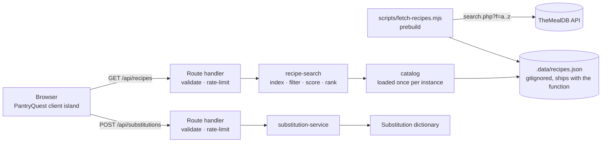

# Scrambl

A recipe finder at `/cooking`. You put the ingredients you already have on a
virtual cutting board; it finds real recipes, shows how well each one matches
your kitchen, says exactly what's missing, suggests substitutions, and walks you
through the instructions one step at a time.

The name lives in one constant (`PROJECT_NAME` in `src/lib/cooking/config.ts`).

## Screenshots

_To add: cutting board with ingredients, order rail, recipe detail with
substitutions, Cooking Mode, and the mobile layout. Save them under
`docs/images/` and link them here._

## How it works



1. **Ingredient entry** — an ARIA combobox with suggestions. Names are validated
   and normalized; duplicates are blocked by normalized name (`Eggs` = `egg`,
   but `red onion` ≠ `green onion`). Suggestions come from the recipe catalog
   (`server/suggestions.ts`, built when `/cooking` is prerendered, so the page
   stays static): every ingredient used by at least 2 recipes, plus any with
   art, most-used first, never a staple. About 470 names, about 6.5 KB; only
   names reach the browser. Without a catalog it falls back to the static
   `INGREDIENT_SUGGESTIONS`. Free text is always allowed.
2. **Catalog (build time)** — `scripts/fetch-recipes.mjs` runs before every
   build and downloads TheMealDB's whole catalog letter by letter
   (`search.php?f=a` … `z`, about 790 recipes, about 1.7 MB after keeping only
   the fields the app uses). It writes `.data/recipes.json`, which is
   gitignored and never under `public/`; file tracing ships it with the
   `/api/recipes` function. Runtime searches never call TheMealDB.
3. **Search (server)** — the catalog is read once per server instance,
   normalized, and indexed by ingredient match key. A search then:
   1. takes every recipe that shares at least one non-staple ingredient with
      the board (via the index),
   2. applies the dietary filters to all of them,
   3. scores each against the whole board, with pantry staples assumed,
   4. keeps recipes that match at least one real (non-staple) board item,
   5. ranks them and returns the top 12.
4. **Results** — the best match is served on a plate above the rail, with a
   gold "Best match" ribbon and a reason line ("Only 1 ingredient to buy.").
   The other 11 hang on the order rail under "Also on the menu"; sorting
   reorders only the rail. Every card leads with a headline ("Ready to cook",
   "Need 1 more", "Need N more") above the ingredient-match meter. Changing a
   dietary filter re-runs the search (debounced 250 ms, aborting any search
   in flight), because filters are applied before the top 12 are picked. The
   browser never re-scores or re-filters.
5. **Detail & Cooking Mode** — ingredients with quantities as supplied, steps as
   supplied, attribution links, and a focused step-by-step view.

### Code layout

| Path                                 | Role                                                                                                                                                                                                                                                                                                 |
| ------------------------------------ | ---------------------------------------------------------------------------------------------------------------------------------------------------------------------------------------------------------------------------------------------------------------------------------------------------- |
| `src/app/cooking/page.tsx`           | Route (server component)                                                                                                                                                                                                                                                                             |
| `src/app/api/recipes/route.ts`       | Search endpoint                                                                                                                                                                                                                                                                                      |
| `src/app/api/substitutions/route.ts` | Substitution endpoint                                                                                                                                                                                                                                                                                |
| `src/components/cooking/`            | UI: `PantryQuestHeader` (server), `PantryQuest` (client island), `PantryShelf`, `IngredientInput`, `CuttingBoard`, `StovePot`, `FlyingIngredients`, `IngredientIllustration`, `DietaryFilters`, `RecipeResults` (order rail), `RecipeCard`, `RecipeDetail`, `SubstitutionSuggestions`, `CookingMode` |
| `src/lib/cooking/*.ts`               | Pure, client-safe logic: types, config, normalizer, matcher, dietary filter, validation, recipe normalizer, substitutions dictionary, asset map                                                                                                                                                      |
| `src/lib/cooking/server/`            | Server-only: `catalog.ts` (loads and indexes `.data/recipes.json`), `recipe-search.ts` (filter, score, rank), substitution service                                                                                                                                                                   |
| `scripts/fetch-recipes.mjs`          | Build-time catalog fetch (`prebuild`, `predev --if-stale`, `npm run refresh:recipes`)                                                                                                                                                                                                                |

TheMealDB records are normalized into an internal `Recipe` model
(`recipe-normalizer.ts`) when the catalog loads, so the UI never depends on
TheMealDB's field names. The catalog file keeps TheMealDB's raw shape; all
normalization happens at runtime in TypeScript.

## API

### `GET /api/recipes`

Query: `ingredients` (comma-separated, 1–15, each ≤ 40 chars), optional
`diet` (`vegetarian,vegan,dairy-free,gluten-free`).

`200` → `{ matches: RecipeMatch[], meta: { provider, recipeCount, candidateCount, filteredOutCount, catalogDate } }`

- `matches`: at most 12, ranked; `matches[0]` is the best match.
- `recipeCount`: recipes in the build's catalog. `candidateCount`: recipes
  sharing a non-staple ingredient with the board. `filteredOutCount`:
  candidates removed by dietary filters. `catalogDate`: when the catalog was
  fetched.

`400` invalid input · `429` rate limited · `503`
`{ error: "Recipe data isn't available in this build.", retryable: false }`
when the build has no catalog. Errors are `{ error, retryable }`, with no stack
traces or internal details. Every response is `Cache-Control: no-store` (they
reflect your pantry).

### `POST /api/substitutions`

Body (≤ 4 KB): `{ recipeTitle, missing: string[] (1–10), available?: string[], diet?: string[] }`

`200` → `{ suggestions: Substitution[], skipped: { ingredient, reason }[] }`
`400` invalid · `413` too large · `429` rate limited. Once validated it always
returns 200.

Rate limits (30/min search, 10/min substitutions per IP) are in-memory per
server instance: a guard against runaway loops, not a security boundary.
Searches are cheap (in-memory scoring, no upstream calls), and each dietary
filter change runs one, hence the higher search limit.

## Matching algorithm

Implemented in `src/lib/cooking/recipe-matcher.ts` as a pure function.

**Normalization** (`ingredient-normalizer.ts`): lowercase, strip accents and
punctuation, collapse whitespace, singularize the last word, apply a small alias
table (`scallions` → `green onion`, `cornflour` → `cornstarch`). For _matching_
only, preparation/cut words are also dropped (`minced garlic` → `garlic`,
`chicken breasts` → `chicken`). Words that change what an ingredient _is_ are
never dropped: `chicken stock` ≠ `chicken`, `green onion` ≠ `onion`,
`bell pepper` ≠ `black pepper`.

**Formula.** Recipe lines are de-duplicated by match key. Ingredients the source
explicitly marks optional are excluded from the denominator.

```
matchPercentage = round(100 × matched / total)
```

If a source marks core ingredients, the score becomes
`0.8 × requiredCoverage + 0.2 × coreCoverage`. TheMealDB supplies neither
optional nor core flags, so in practice the plain coverage formula applies;
the weighted path is implemented and tested for future providers.

Pantry staples are always assumed available (there is no toggle): salt, sea
salt, kosher salt, pepper, black pepper, water (cold, warm, hot, boiling), and
cooking oils (oil, olive, vegetable, sunflower, canola, rapeseed). They're
listed as match keys in `PANTRY_STAPLES`, so "Extra Virgin Olive Oil" counts as
olive oil. Flavoring oils (sesame, chilli, truffle) are not staples. Staples
are named in the explanation, at most two then a count ("You have 7 of 8
listed ingredients (salt and olive oil assumed).") and can't make a recipe
relevant on their own: a result must match at least one non-staple board item.

In the UI, a **Pantry basics** strip sits just above the knife at the bottom
of the cutting board: salt, pepper, oil and water as text chips with an
"Always stocked" tag (text, not sprites: the pack has art for salt only). It
isn't interactive and doesn't count toward the board's ingredients.

Cards never list staples as things you have:

- **From your board** — matched ingredients only.
- **Missing** — what you'd need to buy.
- **Pantry basics** — the assumed staples (plate and detail view only).
- **Not used from your board: …** — board items the recipe ignores (plate,
  tickets and detail view, only when there are any; staples excluded).

Rail tickets drop the explanation sentence, which repeats the headline, meter
and lists; the plate and detail view keep it. In the recipe detail, assumed
lines get a different icon and a "From your pantry" chip.

**Generic names.** TheMealDB names ingredients specifically and UK-style, so
some generics matched nothing. Match-only aliases (`MATCH_ALIASES` in
`ingredient-normalizer.ts`) fix the clear cases found by auditing the catalog:

| Board item     | Now also matches                                                  |
| -------------- | ----------------------------------------------------------------- |
| `pasta`        | spaghetti, macaroni, penne, fettuccine, linguine, bowtie pasta, … |
| `bell pepper`  | red / green / yellow pepper                                       |
| `chili`        | chilli, red chilli, green chilli                                  |
| `corn`         | sweetcorn, corn on the cob                                        |
| `tomato paste` | tomato purée                                                      |
| `cream`        | double, heavy and whipping cream                                  |
| `fish`         | white fish                                                        |
| `lentil`       | brown lentils                                                     |

Pasta shapes are treated as interchangeable, so a board `spaghetti` also
matches a `Penne Pasta` line. Lasagne sheets, noodles, chilli powder, cayenne
and red pepper flakes, sour cream and fish sauce keep their own keys. The
aliases apply to match keys only: dietary filters and food-safety checks still
read each line's own name (`Penne Pasta` is still gluten), and substitutions
look up the specific name first (tomato purée gets the purée swap).

**Ranking** (`compareBestMatch`): most board items used first (pantry
staples don't count), then highest match %, then fewest missing, then title,
then id. The results say so in one line ("Ranked by how many of your
ingredients each recipe uses, then ingredient match, then fewest to buy."). The sort menu
offers this ("Best match"), "Highest match %", and "A–Z", and applies only to
the rail; the best match on the plate never moves.

It's labeled **Ingredient match** because that's all it is — coverage, not a
prediction of taste or success.

## Substitutions

- **Substitution dictionary** (`src/lib/cooking/substitutions.ts`): 46 common
  kitchen swaps across 42 ingredients, with ratios and trade-offs, labeled
  "General tip".
- **Safety rules**: no substitutes are suggested for raw meat, poultry, seafood,
  or eggs (swapping them changes safe handling and cooking temperatures) — these
  are listed as skipped with a reason. Suggestions that conflict with selected
  dietary filters are removed. The UI states that substitutions are suggestions
  and never allergy advice.
- Suggestions are fetched only when you click **Suggest substitutions**, never
  per keystroke.

## Dietary filters

Best-effort, in `src/lib/cooking/dietary-filter.ts`. TheMealDB has no per-recipe
diet flags, so the filter uses its meat/seafood **categories** first, then scans
each ingredient line against conservative whole-word lists with explicit
exceptions (`coconut milk`, `rice flour`, `oyster mushroom`, `gluten-free …`).
It errs toward excluding a recipe, and unknown ingredients pass through. **It is
not allergy protection**, and the UI says so.

## Environment variables

All optional and server-only (never `NEXT_PUBLIC_`). See `.env.example`.

| Variable         | Purpose                                     | Default               |
| ---------------- | ------------------------------------------- | --------------------- |
| `RECIPE_API_KEY` | TheMealDB supporter key, used at build time | `1` (public test key) |

The key is read only by `scripts/fetch-recipes.mjs` at build time, never by
app runtime code, and the script never logs it or any request URL. With a key
the script uses TheMealDB's v2 API (v1 `search.php?f=` answers an empty body
for supporter keys) and is strict: if any letter fails after retries, or the
catalog has fewer than `MIN_RECIPES` (710) recipes, it exits non-zero and the
build fails. Without a key it uses v1 with the public test key `1`; on failure
it writes an empty catalog marked `unavailable`, prints a warning, and the
build still succeeds (the page then shows "Recipe data isn't available in this
build.").

## Local setup

```bash
npm install
npm run dev               # fetches the catalog first if it's missing or > 24h old
npm run refresh:recipes   # fetch it now
npm test                  # unit + API + UI tests (no network, no catalog file)
npm run lint
npm run build             # prebuild fetches the catalog
```

No keys are needed locally. If the `predev` fetch can't reach TheMealDB, it
keeps an existing (stale) catalog. The catalog is cached per server process,
so restart the dev server after `refresh:recipes`.

## Testing

Vitest + Testing Library (`npm test`):

- **Unit** — normalization and aliases (including staple keys, "Egg Plants",
  the generic-name aliases and the words they must never merge), suggestions
  (staples excluded, minimum count, order, validity, empty without a catalog), card labels
  (`unusedBoardItems`, reason lines), scoring (full/none/partial, rounding, empty lists, duplicates,
  optional and core weighting, staples), ranking and sorting, dietary rules
  and exceptions, food-safety detection, substitution lookup, recipe
  normalization of partial/malformed records, request validation, catalog
  loading and indexing (missing/invalid file → unavailable), and search
  (ranking, the real-match rule, diet before the top 12, staple variants, and
  a fast-check property comparing results to a brute-force top 12).
- **Build script** (`scripts/__tests__/fetch-recipes.test.ts`) — field
  picking, de-duplication, non-array `meals`, `MIN_RECIPES`, strict-with-key vs
  lenient-without-key, the 24h freshness skip, and that the key and URLs never
  appear in log output. Uses a fake `fetch`; no network.
- **API** (`src/app/api/__tests__/routes.test.ts`, node environment, in-memory
  catalog) — ranked results, server-side diet filtering, input rejection, the
  503 when the catalog is unavailable, 30/min rate limit, `no-store`, and
  substitution suggestions.
- **UI** (`src/components/cooking/__tests__/PantryQuest.test.tsx`) — adding
  with Enter and the button, keyboard suggestion selection, Escape, duplicate
  prevention, removal, clear-all, disabled search, the best-match plate
  (ribbon, reason, headline) and the rail of the rest with rail-only sorting,
  the pantry basics strip (not counted, not interactive), "From your board"
  and "Pantry basics" kept apart (pantry basics on the plate only), the "Not
  used from your board" line, lean rail tickets, the "From your pantry" chip,
  suggestions driven by the `suggestions` prop and never offering staples, no
  staples toggle, no-results, error and retry, the 503
  message, a debounced diet re-search (exactly one request), the
  filters-empty state, recipe detail focus, substitutions, Cooking Mode
  navigation by button and arrow key, pantry-shelf toggles, dropping a shelf
  item onto the board, and the post-search reveal + "Order up!" shortcut.
- **Illustration** (`IngredientIllustration.test.tsx`) — pack art for a known
  ingredient (matched by key), the "no art" box for a known ingredient the
  pack lacks, the "?" box for an unrecognized one, and that every resolved
  image path and both fallback boxes exist on disk.

Not automated yet: visual/responsive checks and screen-reader testing, which
need a real browser and assistive tech.

## Deployment

Works on Vercel with no configuration: `npm run build` runs `prebuild`, which
fetches the catalog with the test key.

- **Production:** `RECIPE_API_KEY` is set in **Project → Settings →
  Environment Variables** for Production only (server-only, never
  `NEXT_PUBLIC_`). Keyed builds are strict, so a TheMealDB outage fails the
  build and Vercel keeps the previous production deployment.
- **Preview:** no key, so builds use the public test key `1` (TheMealDB allows
  it for development and educational use). If that fetch fails, the preview
  still deploys and shows the "not available" message.
- **Freshness:** the catalog is fetched on every build, so new TheMealDB
  recipes appear on the next deploy.
- **File tracing:** `outputFileTracingIncludes` in `next.config.ts` ships
  `.data/recipes.json` with the `/api/recipes` function. Check the first
  preview deployment (search returns results, not a 503) before production
  relies on it.

A search is one function invocation with no network calls. Measured locally:
loading the catalog takes about 50 ms once per instance, and a 5-ingredient
search scores about 450 candidates in about 10 ms (about 20 ms with diet
filters).

Smoke test after deploying: open `/cooking`, add `chicken` and `rice`, search,
open a result, request substitutions, toggle a dietary filter, and step through
Cooking Mode.

## Layout

The page is a kitchen counter, stacked on mobile and three columns from `lg`.
The static header (`PantryQuestHeader`) is server-rendered in `app/cooking/
page.tsx`; everything interactive lives in the one `PantryQuest` client island.
A guidance line above the board reflects the current state (empty board,
ingredients ready, searching, results, error).

- **Pantry shelf** (`PantryShelf`): 12 common ingredients
  (`SHELF_INGREDIENTS`). Each is a toggle button (`aria-pressed`) that adds or
  removes it, so it works with touch and keyboard. Dragging an item onto the
  cutting board is a mouse-only extra.
- **Cutting board**: the typed input, the ingredients on the board, the
  **Pantry basics** strip (text chips, just above the knife), and
  the **Find my recipe** pixel knife (`KnifeButton`) resting at the bottom
  right.
- **Stove + order ticket**: the pot (`StovePot`), then the dietary filters.
  On search, copies of the board's sprites arc into the pot
  (`FlyingIngredients`, max 8), and the pot steams and bobs while loading.
  The hop only runs when both the board and pot are on screen.
- **Results** (`RecipeResults`): the best match (`BestMatchPlate`) is served
  as the dish the pot made: a counter panel with the photo on a round plate, a
  gold "Best match" ribbon, the reason line, headline, meter and have/missing
  summary. Full width on mobile, photo left and details right from `lg`. It
  slides up on arrival (skipped under reduced motion). The rest hang as
  tickets on a steel rail labelled "Also on the menu" that scrolls sideways
  with snap points and prev/next buttons. Opening a ticket drops the detail
  view in from above.
- **Reveal**: when a search settles (results or error) and the hop has
  finished, the page scrolls to the rail (skipped if it's already on screen)
  and focus moves to its heading. An **Order up!** button on the stove jumps
  back down to it later.

Under `prefers-reduced-motion`, the hop, ticket drop, detail slide, and pot
bob/steam are skipped.

## Ingredient art

Most ingredients use pixel-art icons from **Pixeltier's Food & Cooking RPG
Icons** (16×16 PNGs in `public/images/ingredients/`; see CREDITS.md).

Rendering per ingredient (`IngredientIllustration`):

1. a known ingredient with pack art renders its PNG
2. a known ingredient the pack doesn't cover (honey, ginger, shrimp, soy sauce,
   olive oil, black pepper) renders `no-art.svg` — a pixel crate with a
   fork + knife
3. an unrecognized / free-text ingredient renders `unknown.svg` — a pixel "?"
   crate

On the cutting board, ingredients render "bare" (directly on the wood); lists
elsewhere use the tinted tile. Images use `image-rendering: pixelated` so the
16×16 art stays crisp when scaled. A test checks that every resolved
`imagePath` points at a real file.

**Adding art:** drop a file in `public/images/ingredients/`, set `file` on the
matching entry in `ingredient-assets.ts`, and record the source and license in
[`public/images/ingredients/CREDITS.md`](../public/images/ingredients/CREDITS.md).

## Recipe data attribution

Recipes, ingredient lists, instructions, and photos come from
[TheMealDB](https://www.themealdb.com/). Every result links to its TheMealDB page,
and to the original author's page when TheMealDB supplies one.

## Known limitations

- The catalog is a snapshot taken at build time; recipes added to TheMealDB
  appear on the next deploy.
- Synonym handling is a small hand-written table, not an ontology. Some
  generics still match little, by choice: `beans` (the catalog only has kinds:
  green, kidney, black, cannellini…), `noodles` (rice, egg and udon noodles
  aren't interchangeable), and `tofu` (silken and marinated are rare).
- No prep/cook times, servings, nutrition, or optional-ingredient data — the
  provider doesn't supply them, so the UI doesn't show them.
- Instructions are split on the source's line breaks; a recipe written as one
  paragraph appears as one step.
- Dietary filtering is best-effort keyword matching.
- Rate limiting and the loaded catalog are per server instance.

## Future improvements

Favorites and saved pantry,
user accounts, nutrition and allergen data from a
reliable source, more ingredient art, recipe scaling and unit conversion,
shareable recipe links, and multilingual recipes.
