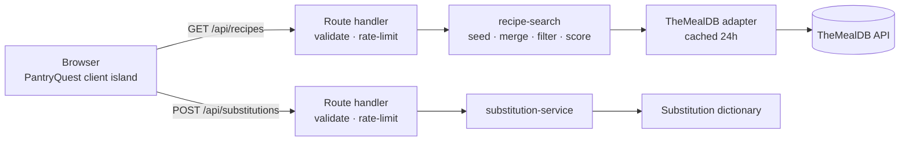

# Pantry Quest

A recipe finder at `/cooking`. You put the ingredients you already have on a
virtual cutting board; it finds real recipes, shows how well each one matches
your kitchen, says exactly what's missing, suggests substitutions, and walks you
through the instructions one step at a time.

The name lives in one constant (`PROJECT_NAME` in `src/lib/cooking/config.ts`).

## Screenshots

_To add: cutting board with ingredients, order rail, recipe detail with
substitutions, Cooking Mode, and the mobile layout. Save them under
`docs/images/` and link them here._

## How it works



1. **Ingredient entry** — an ARIA combobox with suggestions. Names are validated
   and normalized; duplicates are blocked by normalized name (`Eggs` = `egg`,
   but `red onion` ≠ `green onion`).
2. **Search** — the free TheMealDB tier filters by **one ingredient per call**,
   so the server queries up to 3 of your most distinctive ingredients (common
   ones like salt, garlic, onion go last), merges candidate ids (recipes found
   under more seeds rank first), and fetches full details for the top 12.
3. **Score** — every candidate is scored locally against your _whole_ board.
4. **Filter & sort** — dietary filters, the staples toggle, and sorting run live
   in the browser with the same pure functions the server uses, so toggling
   them never refetches and the numbers always agree.
5. **Detail & Cooking Mode** — ingredients with quantities as supplied, steps as
   supplied, attribution links, and a focused step-by-step view.

### Code layout

| Path                                 | Role                                                                                                                                                                                                                                                                                                 |
| ------------------------------------ | ---------------------------------------------------------------------------------------------------------------------------------------------------------------------------------------------------------------------------------------------------------------------------------------------------- |
| `src/app/cooking/page.tsx`           | Route (server component)                                                                                                                                                                                                                                                                             |
| `src/app/api/recipes/route.ts`       | Search endpoint                                                                                                                                                                                                                                                                                      |
| `src/app/api/substitutions/route.ts` | Substitution endpoint                                                                                                                                                                                                                                                                                |
| `src/components/cooking/`            | UI: `PantryQuestHeader` (server), `PantryQuest` (client island), `PantryShelf`, `IngredientInput`, `CuttingBoard`, `StovePot`, `FlyingIngredients`, `IngredientIllustration`, `DietaryFilters`, `RecipeResults` (order rail), `RecipeCard`, `RecipeDetail`, `SubstitutionSuggestions`, `CookingMode` |
| `src/lib/cooking/*.ts`               | Pure, client-safe logic: types, config, normalizer, matcher, dietary filter, validation, recipe normalizer, substitutions dictionary, asset map                                                                                                                                                      |
| `src/lib/cooking/server/`            | Server-only: TheMealDB adapter, search orchestration, substitution service                                                                                                                                                                                                                           |

The provider sits behind a `RecipeProvider` interface
(`findCandidateIds`, `getRecipe`), and its responses are normalized into an
internal `Recipe` model, so another provider can be added without touching UI.

## API

### `GET /api/recipes`

Query: `ingredients` (comma-separated, 1–15, each ≤ 40 chars), optional
`diet` (`vegetarian,vegan,dairy-free,gluten-free`), optional `staples=1`.

`200` → `{ matches: RecipeMatch[], meta: { provider, queriedIngredients, filteredOutCount, partial } }`
`400` invalid input · `429` rate limited · `502` provider unavailable.
Errors are `{ error, retryable }` — no stack traces or upstream details.
Responses are `Cache-Control: no-store` (they reflect your pantry); upstream
recipe data is cached for 24h inside the adapter.

### `POST /api/substitutions`

Body (≤ 4 KB): `{ recipeTitle, missing: string[] (1–10), available?: string[], diet?: string[] }`

`200` → `{ suggestions: Substitution[], skipped: { ingredient, reason }[] }`
`400` invalid · `413` too large · `429` rate limited. Once validated it always
returns 200.

Rate limits (30/min search, 10/min substitutions per IP) are in-memory per
server instance: a guard against runaway loops, not a security boundary.

## Matching algorithm

Implemented in `src/lib/cooking/recipe-matcher.ts` as a pure function.

**Normalization** (`ingredient-normalizer.ts`): lowercase, strip accents and
punctuation, collapse whitespace, singularize the last word, apply a small alias
table (`scallions` → `green onion`, `cornflour` → `cornstarch`). For _matching_
only, preparation/cut words are also dropped (`minced garlic` → `garlic`,
`chicken breasts` → `chicken`). Words that change what an ingredient _is_ are
never dropped: `chicken stock` ≠ `chicken`, `green onion` ≠ `onion`,
`bell pepper` ≠ `black pepper`.

**Formula.** Recipe lines are de-duplicated by match key. Ingredients the source
explicitly marks optional are excluded from the denominator.

```
matchPercentage = round(100 × matched / total)
```

If a source marks core ingredients, the score becomes
`0.8 × requiredCoverage + 0.2 × coreCoverage`. TheMealDB supplies neither
optional nor core flags, so in practice the plain coverage formula applies;
the weighted path is implemented and tested for future providers.

With "Assume I have salt, pepper & water" on, those staples count as available
and are listed separately in the explanation ("You have 7 of 8 listed
ingredients (including 2 assumed pantry staples).").

It's labeled **Ingredient match** because that's all it is — coverage, not a
prediction of taste or success.

## Substitutions

- **Substitution dictionary** (`src/lib/cooking/substitutions.ts`): 46 common
  kitchen swaps across 42 ingredients, with ratios and trade-offs, labeled
  "General tip".
- **Safety rules**: no substitutes are suggested for raw meat, poultry, seafood,
  or eggs (swapping them changes safe handling and cooking temperatures) — these
  are listed as skipped with a reason. Suggestions that conflict with selected
  dietary filters are removed. The UI states that substitutions are suggestions
  and never allergy advice.
- Suggestions are fetched only when you click **Suggest substitutions**, never
  per keystroke.

## Dietary filters

Best-effort, in `src/lib/cooking/dietary-filter.ts`. TheMealDB has no per-recipe
diet flags, so the filter uses its meat/seafood **categories** first, then scans
each ingredient line against conservative whole-word lists with explicit
exceptions (`coconut milk`, `rice flour`, `oyster mushroom`, `gluten-free …`).
It errs toward excluding a recipe, and unknown ingredients pass through. **It is
not allergy protection**, and the UI says so.

## Environment variables

All optional and server-only (never `NEXT_PUBLIC_`). See `.env.example`.

| Variable         | Purpose                 | Default               |
| ---------------- | ----------------------- | --------------------- |
| `RECIPE_API_KEY` | TheMealDB supporter key | `1` (public test key) |

The key is read only in `src/lib/cooking/server/`, which only route handlers
import. Tests assert it never appears in any API response.

## Local setup

```bash
npm install
npm run dev            # http://localhost:3000/cooking
npm test               # unit + API + UI tests
npm run lint
npm run build
```

No keys are needed to use the feature locally.

## Testing

Vitest + Testing Library (`npm test`):

- **Unit** — normalization and aliases, scoring (full/none/partial, rounding,
  empty lists, duplicates, optional and core weighting, staples), sorting,
  dietary rules and exceptions, food-safety detection, substitution lookup,
  recipe normalization of partial/malformed records, request validation, and
  search orchestration with a fake provider (merging, partial failure, total
  failure).
- **API** (`src/app/api/__tests__/routes.test.ts`, node environment, stubbed
  `fetch`) — normalized results, input rejection, safe 502s, `no-store`,
  substitution suggestions, and that the provider key never appears in
  responses.
- **UI** (`src/components/cooking/__tests__/PantryQuest.test.tsx`) — adding
  with Enter and the button, keyboard suggestion selection, Escape, duplicate
  prevention, removal, clear-all, disabled search, computed scores, no-results,
  error and retry, live dietary filtering, recipe detail focus, substitutions,
  Cooking Mode navigation by button and arrow key, pantry-shelf toggles,
  dropping a shelf item onto the board, and the post-search reveal + "Order
  up!" shortcut.
- **Illustration** (`IngredientIllustration.test.tsx`) — pack art for a known
  ingredient (matched by key), the "no art" box for a known ingredient the
  pack lacks, the "?" box for an unrecognized one, and that every resolved
  image path and both fallback boxes exist on disk.

Not automated yet: visual/responsive checks and screen-reader testing, which
need a real browser and assistive tech.

## Deployment

Works on Vercel with no configuration. To use a TheMealDB supporter key, add
`RECIPE_API_KEY` in **Project → Settings → Environment Variables** and redeploy.

Smoke test after deploying: open `/cooking`, add `chicken` and `rice`, search,
open a result, request substitutions, and step through Cooking Mode.

Before a public launch, get a TheMealDB supporter key: their terms allow the
test key `1` for development and educational use only.

## Layout

The page is a kitchen counter, stacked on mobile and three columns from `lg`.
The static header (`PantryQuestHeader`) is server-rendered in `app/cooking/
page.tsx`; everything interactive lives in the one `PantryQuest` client island.
A guidance line above the board reflects the current state (empty board,
ingredients ready, searching, results, error).

- **Pantry shelf** (`PantryShelf`): 12 common ingredients
  (`SHELF_INGREDIENTS`). Each is a toggle button (`aria-pressed`) that adds or
  removes it, so it works with touch and keyboard. Dragging an item onto the
  cutting board is a mouse-only extra.
- **Cutting board**: the typed input, the ingredients on the board, and the
  **Find my recipe** pixel knife (`KnifeButton`) resting at the bottom right.
- **Stove + order ticket**: the pot (`StovePot`), then the dietary filters.
  On search, copies of the board's sprites arc into the pot
  (`FlyingIngredients`, max 8), and the pot steams and bobs while loading.
  The hop only runs when both the board and pot are on screen.
- **Order rail** (`RecipeResults`): results hang as tickets on a steel rail
  that scrolls sideways with snap points and prev/next buttons. Opening a
  ticket drops the detail view in from above.
- **Reveal**: when a search settles (results or error) and the hop has
  finished, the page scrolls to the rail (skipped if it's already on screen)
  and focus moves to its heading. An **Order up!** button on the stove jumps
  back down to it later.

Under `prefers-reduced-motion`, the hop, ticket drop, detail slide, and pot
bob/steam are skipped.

## Ingredient art

Most ingredients use pixel-art icons from **Pixeltier's Food & Cooking RPG
Icons** (16×16 PNGs in `public/images/ingredients/`; see CREDITS.md).

Rendering per ingredient (`IngredientIllustration`):

1. a known ingredient with pack art renders its PNG
2. a known ingredient the pack doesn't cover (honey, ginger, shrimp, soy sauce,
   olive oil, black pepper) renders `no-art.svg` — a pixel crate with a
   fork + knife
3. an unrecognized / free-text ingredient renders `unknown.svg` — a pixel "?"
   crate

On the cutting board, ingredients render "bare" (directly on the wood); lists
elsewhere use the tinted tile. Images use `image-rendering: pixelated` so the
16×16 art stays crisp when scaled. A test checks that every resolved
`imagePath` points at a real file.

**Adding art:** drop a file in `public/images/ingredients/`, set `file` on the
matching entry in `ingredient-assets.ts`, and record the source and license in
[`public/images/ingredients/CREDITS.md`](../public/images/ingredients/CREDITS.md).

## Recipe data attribution

Recipes, ingredient lists, instructions, and photos come from
[TheMealDB](https://www.themealdb.com/). Every result links to its TheMealDB page,
and to the original author's page when TheMealDB supplies one.

## Known limitations

- Free-tier search is one ingredient per request, so results come from at most
  3 seed ingredients and 12 detail lookups per search.
- TheMealDB's ingredient filter matches its own naming; a few aliases are mapped
  (`green onion` → `spring onions`, `cilantro` → `coriander`) but not all.
- Synonym handling is a small hand-written table, not an ontology.
- No prep/cook times, servings, nutrition, or optional-ingredient data — the
  provider doesn't supply them, so the UI doesn't show them.
- Instructions are split on the source's line breaks; a recipe written as one
  paragraph appears as one step.
- Dietary filtering is best-effort keyword matching.
- Rate limiting is per server instance.

## Future improvements

Favorites and saved pantry, user accounts, nutrition and allergen data from a
reliable source, more ingredient art, a provider with real multi-ingredient
search, recipe scaling and unit conversion, shareable recipe links, and
multilingual recipes.
